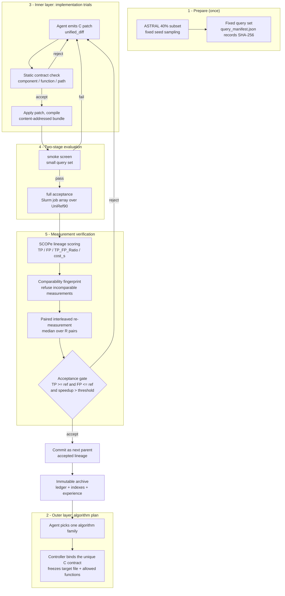

# SeqOpt

**LLM-Guided Code Optimization and Reliable Evaluation for Biological Sequence Search**

SeqOpt drives a language-model agent to propose patches against the C internals of HMMER's
`jackhmmer` iterative protein search, evaluates every candidate on a fixed query set against
UniRef90 under hard TP/FP non-regression gates, and — the part this project focuses on — tries
to answer *whether a measured speedup is signal or noise*.

> SeqOpt builds on the upstream [EvoMaster](https://github.com/sjtu-sai-agents/EvoMaster)
> agent framework. EvoMaster provides the agent infrastructure; SeqOpt contributes the
> sequence-search optimization engine, its evaluation protocol, and its measurement
> verification layer. See [Relationship to upstream](#relationship-to-upstream).

---

## Table of contents

- [Overview](#overview)
- [Motivation](#motivation)
- [Key features](#key-features)
- [Architecture](#architecture)
- [Installation](#installation)
- [Configuration](#configuration)
- [Quick start](#quick-start)
- [Evaluation protocol](#evaluation-protocol)
- [Reproducing experiments](#reproducing-experiments)
- [Results](#results)
- [Limitations](#limitations)
- [Project structure](#project-structure)
- [Relationship to upstream](#relationship-to-upstream)
- [License](#license)
- [Acknowledgements](#acknowledgements)
- [Citation](#citation)

---

## Overview

`jackhmmer` is the standard tool for iterative protein homology search: starting from one query
it repeatedly searches a sequence database with `hmmsearch`, folds the hits into a profile, and
iterates. It is widely used to collect homologs before building profiles, and its wall-clock time
is often the bottleneck of the surrounding pipeline.

The usual way to make it faster is to loosen parameters (`-E`, `--incE`, iteration counts), but
every such change **directly trades away recall**. SeqOpt takes a different route: it changes
the *algorithm implementation* — filter cascades, DP recurrences, the vectorized SSV filter,
null2 correction, sequence I/O — while keeping search semantics equivalent, and it does so
through C source patches proposed by an LLM agent.

That reframing turns a pure algorithms problem into a **measurement** problem. Expected speedups
are single-digit percentages, and the wall-clock of one query on a shared cluster fluctuates by a
comparable amount. So "how do we confirm a speedup is real" matters as much as "how do we find
one", and engineering the former is the core of this repository.

---

## Motivation

Three properties of the setting drove the design:

1. **Quality must not silently degrade.** A patch that drops hits can look like a win on
   wall-clock alone. SeqOpt therefore treats TP/FP as hard gates, not as a term to trade
   against time.
2. **Timing noise is the same order of magnitude as the effect.** Comparing a freshly measured
   candidate against a cost stored by an earlier run charges run-to-run drift to the patch. A
   deliberately score-neutral probe patch once "won" 76% that way.
3. **A structural check is not a scientific check.** Verifying that a patch applies, compiles, and
   touches a permitted file says nothing about whether it is faster or quality-preserving.
   Conflating the two is the main way an optimization loop can produce confident nonsense.

---

## Key features

**Optimization loop**

- LLM-proposed **C source patches** restricted to a whitelist of component contracts (target file
  + permitted functions); anything outside is rejected statically.
- **Two-level search**: an outer algorithm-plan layer chooses one decision surface per round and
  freezes its contract; an inner layer generates and evaluates implementation variants.
- **Two-stage evaluation**: a cheap `smoke` screen, then a `full` acceptance run that is the only
  basis for a commit. A missing full result fails the candidate; smoke results are never promoted
  into acceptance evidence.
- **Content-addressed binary bundles**: a candidate is compiled once and reused across all query
  tasks, and any input change yields a different bundle id.
- **Slurm job arrays** with query-level parallelism for the full stage.

**Measurement verification**

- **Comparability fingerprint** (`c_patch_loop/comparability.py`): refuses to compare two cost
  numbers unless backend, allocated cores, thread count, stage, query set, `max_iter`, and the
  three reference-database hashes all match. On mismatch it raises `IncomparableMeasurement`
  instead of returning a speedup.
- **Paired interleaved re-measurement**: the candidate and the current best are measured
  alternately inside the same job, and the median of the per-pair ratios decides
  (`accepted_speedup_paired`), which cancels drift that a stored-cost comparison would charge to
  the patch.
- **Zero-effect calibration**: the same binary is run against itself as arms A and B to quantify
  how large a "speedup" pure noise can produce.
- **Decoy probes**: a patch that provably only *adds* work (re-running `get_xE()` plus a matching
  busy-wait) is injected to test whether the acceptance gate can be fooled.
- **Immutable run records**: every patchset, evaluation, and context pack is written to the run
  directory with input hashes, plus an append-only experiment ledger.

**Layered experience memory**

Raw evidence is immutable; indexes over it are regenerable; the summary handed to the model is
compressed and carries `eval_id` / `patchset_id` / `diff_sha256` back-references. Measured facts
and the model's own causal interpretation are stored separately so a later agent does not inherit
a hypothesis as if it were evidence.

---

## Architecture



The outer layer decides *which decision surface* to change, the inner layer decides *how*, and the
evaluation layer decides *whether it counts*. Keeping these separate means each round touches
exactly one C component, so attributing an outcome stays tractable.

The outer layer chooses one algorithm family from the eleven the engine accepts (six canonical
families plus five accepted aliases); the controller then binds that family to exactly one active
component contract and freezes its target file and permitted functions for the round.

### Patchable component contracts

Patches may only land in the files and functions listed below. Anything else is rejected during
static validation, before any evaluation cost is spent.

**Active contracts** (these are the ones new proposals may target; the test cluster is AArch64, so
the NEON paths are the live ones):

| Component | Target file | Role |
|---|---|---|
| `pipeline_flow` | `src/p7_evo_align.c` | Search pipeline decision surface |
| `jackhmmer_loop` | `src/p7_evo_iter.c` | Iterative search state machine |
| `dp_kernel_neon` | `impl_neon/fwdback.c` | DP forward/backward recurrence |
| `ssv_filter_neon` | `impl_neon/ssvfilter.c` | SSV filter / vectorized band scoring |
| `null2_correction_neon` | `impl_neon/null2.c` | null2 bias correction |
| `sequence_io` | `easel/esl_sqio_ascii.c` | FASTA streaming input |

**Legacy contracts**, kept only so historical content-addressed patchsets can be replayed and
audited. New proposals cannot select them.

| Component | Target file | Role |
|---|---|---|
| `dp_kernel` | `impl_sse/fwdback.c` | DP recurrence (SSE) |
| `ssv_filter` | `impl_sse/ssvfilter.c` | SSV filter (SSE) |
| `null2_correction` | `impl_sse/null2.c` | null2 bias correction (SSE) |
| `domain_def` | `src/p7_domaindef.c` | Domain posterior definition |

`p7_evo_align.c` and `p7_evo_iter.c` are interface layers added by this project specifically to
expose an editable boundary, so that patches have a stable public contract and an exact stock
fallback. They ship as a patch against pristine HMMER 3.4 — see [`patches/`](patches/).

---

## Installation

### Requirements

| Requirement | Version | Needed for |
|---|---|---|
| Python | **≥ 3.10** | everything |
| `pydantic` ≥ 2, `PyYAML` | per `requirements.txt` | engine |
| `pytest` | any recent | test suite |
| HMMER 3.4 sources | 3.4 | the tests and runs that read or rebuild HMMER C sources |
| Slurm | site-specific | real `full` evaluations |
| Reference databases | see below | real `full` evaluations |

> **Python 3.10 or newer is a hard requirement.** `c_patch_loop/models.py` uses PEP 604 unions
> such as `str | None`, which pydantic v2 evaluates at runtime. On Python 3.9 this raises
> `TypeError: Unable to evaluate type annotation 'str | None'`. `requirements.txt` lists
> `eval_type_backport` as a 3.9 fallback, but do not rely on it.

### Steps

```bash
git clone https://github.com/lyx128060/SeqOpt.git
cd SeqOpt

python3.10 -m venv .venv
.venv/bin/pip install --upgrade pip
.venv/bin/pip install -r requirements.txt
.venv/bin/pip install pytest
```

### Sanity check

```bash
.venv/bin/python examples/validate_examples.py
```

This validates the bundled example proposals against the **live component contracts** and reports
whether an HMMER source tree is present. It takes seconds and catches path or environment problems
before you run the full suite.

### HMMER 3.4 sources

The engine patches and rebuilds real HMMER C sources, so it needs a pristine HMMER 3.4 tree at
`tools/hmmer-3.4/`. That tree is **not vendored** here: it is ~98 MB and is HMMER's own
copyrighted work under BSD-3-Clause, so it belongs with HMMER rather than with this repository.
Fetch, verify, patch, and build it with:

```bash
bash scripts/setup_hmmer.sh
```

The script downloads the official release from `eddylab.org`, verifies its SHA-256, applies
[`patches/0001-expose-optimization-islands.patch`](patches/0001-expose-optimization-islands.patch),
and builds it. It also creates the `src/src` view described in
[`docs/ARCHITECTURE.md`](docs/ARCHITECTURE.md), because the engine's contract resolver and its
profiling resolver expect slightly different source layouts and both views must agree.

Without this step the offline part of the suite still passes; the 37 tests that need real HMMER
sources are **skipped with an explicit reason** rather than failing.

---

## Configuration

Nothing secret belongs in the repository. Copy the example and fill in your own values:

```bash
cp .env.example .env
cp configs/config.example.yaml configs/config.local.yaml
```

`configs/config.local.yaml` and `.env` are gitignored. Provide credentials and site-specific paths
through environment variables:

| Variable | Meaning |
|---|---|
| `LLM_API_KEY` | API key for the OpenAI-compatible endpoint used by the "model as proposer" path |
| `LLM_MODEL` | Model identifier |
| `LLM_API_BASE` | Base URL of the endpoint |
| `ASTRAL_DB` | ASTRAL 40% subset FASTA |
| `UNIREF_DB` | UniRef90 FASTA (the full-stage search database) |
| `SCOP_TXT` | SCOPe lineage file (`dir.cla.scope.2.08-stable.txt`) |
| `SEQ_ALIGN_SLURM_PARTITION` | Slurm partition for evaluation jobs |
| `SEQALIGN_TEST_UNIREF_DB` | Optional small database used by the test suite instead of UniRef90 |

`SEQ_ALIGN_*` environment variables are read by the engine for backend, Slurm resource shape, and
screening policy. The test suite clears ambient `SEQ_ALIGN_*` variables before each test, so
results do not depend on which shell you happen to be in.

### Reference data

Not distributed here; download from the original sources.

| Data | Used for | Source |
|---|---|---|
| **UniRef90** | search database for `full` evaluation (~60.9 GB) | [UniProt downloads](https://www.uniprot.org/help/downloads) |
| **ASTRAL 40% subset** `astral-scopedom-seqres-gd-sel-gs-bib-40-2.08.fa` | query source and hit domain boundaries | [SCOPe/ASTRAL](https://scop.berkeley.edu/downloads/) |
| **SCOPe lineage** `dir.cla.scope.2.08-stable.txt` | ground-truth lineage for TP/FP | same |

A 112 KB smoke query subset derived from ASTRAL is included under
`workspace/seq_align/data_test/` so the offline paths are runnable. Query sampling is
reproducible: a fixed seed over a fixed ASTRAL file yields the same FASTA, and
`query_manifest.json` records the query ids together with the database SHA-256 values.

---

## Quick start

Everything below runs offline — no cluster, no HMMER build, no multi-gigabyte databases.

```bash
# 1. Contract and example validation
.venv/bin/python examples/validate_examples.py

# 2. Test suite (offline portion)
.venv/bin/python -m pytest tests/ -q
# Expected without HMMER sources: 420 passed, 45 skipped
#   37 skips are requires_hmmer_source   (run scripts/setup_hmmer.sh to enable)
#    7 skips are environment-dependent cases in the original suite
#    1 skip  is the single test needing the optional 'pyhmmer' package
# The exact split depends on your optional dependencies: installing pyhmmer
# turns that last skip into a pass (421 passed, 44 skipped), and providing the
# HMMER source tree turns the 37 skips into passes (463 passed, 2 skipped with
# both present). A failure here is not expected in any of these combinations.

# 3. Drive the engine protocol end to end with synthetic evaluations
.venv/bin/python harness_plugins/hloop_cli.py \
    --run-dir ./runs/demo --outer-rounds 2 --inner-trials 2 --stub-eval
# Prints exactly one JSON object on stdout, e.g.
#   {"status": "needs_proposal", "kind": "algorithm_plan"}

# 4. Full agent-side round trip (synthetic evaluator, proves the wiring)
.venv/bin/python harness_plugins/local_agent_driver.py \
    --run-dir ./runs/sa_demo --outer-rounds 2 --inner-trials 2
# Expected: the engine yields a proposal request per round, then reaches `done`
# with all slots terminal and provenance verified. Rounds typically report
# `not_committed_incomparable` here, which is the comparability fingerprint
# refusing to decide from measurements taken under different conditions — the
# intended behaviour, not a failure.
```

`hloop_cli.py` writes one JSON object to stdout and all logs to stderr, so its output can be piped
straight into `jq`. `--stub-eval` and `local_agent_driver.py` use a **synthetic** evaluator: they
exercise control flow, bookkeeping, and provenance, and they produce **no scientific numbers**.
Never report them as results.

To inspect a run without advancing it:

```bash
.venv/bin/python harness_plugins/hloop_cli.py --run-dir ./runs/demo --status
```

---

## Evaluation protocol

### What is measured

Each candidate is compiled into a `jackhmmer` variant and evaluated per query as:

```
jackhmmer -N<max_iter>  against UniRef90
  -> take the highest-iteration checkpoint
  -> hmmsearch <checkpoint> against the ASTRAL 40% subset
  -> parse hmmsearch.tbl
  -> score against SCOPe lineage  =>  TP, FP
cost_s = wall clock of both stages
```

This pipeline is fixed: the agent may not alter it, and may not invoke HMMER directly from a
shell. If candidate and reference could be evaluated differently, their costs would not be
comparable and any speedup would be meaningless — so this constraint is a prerequisite for
measurement validity, not just tidiness.

### Metrics

| Metric | Definition |
|---|---|
| **TP** | hits whose SCOPe lineage matches the query |
| **FP** | hits whose lineage does not match |
| **TP_FP_Ratio** | `TP / (TP + FP)` |
| **cost_s** | combined wall clock of the jackhmmer and hmmsearch stages |

### Acceptance gate

```
1. Quality:   TP >= reference.TP * accept_min_tp_fraction  and  FP <= reference.FP
2. Speed:     cost_s < reference.cost_s * (1 - min_speedup_fraction)
3. Structure: exactly one component changed
4. Comparability: candidate and reference fingerprints must match, else refuse to decide
5. Paired confirmation: with paired_current_best_repeats >= 2, decide on interleaved re-measurement
```

Only a `full`-stage result can clear this gate. Failures are recorded as trajectory evidence but
never inherited. Ambiguous or incomplete paired evidence is rejected rather than resolved in the
candidate's favour.

### Three kinds of checking, kept strictly apart

**Program-level checks are not scientific validation.** The contract whitelist, patch
applicability, compile check, and provenance hashing tell you a patch *can be applied and compiled
in a permitted place*. They say nothing about speed or quality. In the recorded runs these gates
rejected a large number of candidates (`rejected_patch_apply`, `rejected_compile_error`,
`rejected_plan_diff_binding`), which is useful engineering but not evidence about performance.

**Measurement-level checks are the actual verification.** The comparability fingerprint, paired
interleaved re-measurement, zero-effect calibration, and decoy probes all address whether a number
means anything. See [Results](#results) and [Limitations](#limitations).

**Human judgement is isolated explicitly.** Summaries state measured facts and references only.
Mechanistic or causal interpretations must be registered separately, so a later agent can tell
evidence from hypothesis.

---

## Reproducing experiments

### Offline part (anyone can run this)

```bash
.venv/bin/python -m pytest tests/ -q
bash -n scripts/setup_hmmer.sh
.venv/bin/python examples/validate_examples.py
```

### With HMMER sources

```bash
bash scripts/setup_hmmer.sh
.venv/bin/python -m pytest tests/ -q      # the 37 requires_hmmer_source tests now execute
```

### Zero-effect calibration

The calibration summary is in
[`results/noise_floor_calibration.json`](results/noise_floor_calibration.json), together with the
design of the harness that produced it (same binary in both arms, arms alternating inside one job,
per-query raw costs emitted so the analyser can resample rather than trust a summary).

Re-running it from scratch requires Slurm, UniRef90, and the node-level configuration recorded in
that file. The published artifact is the aggregated statistics, not the raw per-query data.

### Full evaluation

Full evaluation needs Slurm, UniRef90, the ASTRAL/SCOPe files, and an LLM endpoint. Once
`configs/config.local.yaml` and the environment variables above are set, drive the engine through
`harness_plugins/hloop_cli.py` (see [`docs/AGENT_PROMPT.md`](docs/AGENT_PROMPT.md) for the proposal
contract), or use `harness_plugins/sample_queries.py` to regenerate a query set.

> **Honest scope note.** The end-to-end `full` evaluation was **not** re-run while assembling this
> repository, because it requires cluster quota, a 60.9 GB database, and a private LLM endpoint.
> The numbers in [Results](#results) are **recomputations of existing experiment records**, not
> experiments newly produced here. Provenance for each number is stated in `results/`.

---

## Results

Two artifacts are published, both recomputed from the recorded data rather than copied from a
prior report.

### Zero-effect noise floor — measured

Same `jackhmmer` binary in both arms, alternating inside one job; any non-zero A/B ratio is pure
measurement noise.

| Quantity | Value |
|---|---|
| Design | identical binary vs itself, arms alternating inside one job |
| Configuration | Slurm, 8 CPU/query, concurrency 5, 25 queries/pass, `max_iter=1` |
| Passes | 12 (6 replicates × 2 arms) |
| Pass cost | min 12826.4 s / median 13176.8 s / max 13801.3 s |
| Pass cost σ / CV | **332.9 s / 2.53 %** |
| Measured A/B pair ratios | 6 pairs: −3.40 %, −0.89 %, +2.52 %, +0.49 %, **+4.00 %**, −2.81 % |
| Gate statistic σ at R = 1 / 2 / 5 | **2.68 % / 1.70 % / 0.69 %** |

The load-bearing result: in this configuration a single unpaired comparison can report roughly
**+4 % "speedup"** with no change whatsoever.

A caveat about the numbers, stated in the JSON itself: the source report's `pair_speedup.n = 132`
counts pairs produced by **resampling across passes**, which describes a gate that does *not*
cancel drift; only **6** A/B pairs were actually measured. Both are published with their
definitions — do not read 132 as 132 independent experiments. σ at R ≥ 4 is extrapolated and R = 6
is degenerate, as the source report notes.

### Decoy probe — a patch that only adds work was accepted as faster

Artifact: [`results/decoy_probe_finding.json`](results/decoy_probe_finding.json).

| Item | Value |
|---|---|
| Probe | `impl_neon/ssvfilter.c::p7_SSVFilter`, re-runs `get_xE()` then busy-waits k = 1.0 × that duration |
| Why it is a valid decoy | it strictly adds work to the timed region, so under any correct measurement it can only be slower; the proposal's own rationale states it "changes *only* how long the stage takes" |
| Verdict | `accepted_speedup_paired`, median paired speedup **+4.04 %** |
| Interleaved? | **Yes** — candidate and reference did alternate |
| The 5 pair ratios | +23.1 % / +6.8 % / −13.8 % / −10.8 % / +4.0 % (σ = 14.9 %) |
| Within-arm cost spread | candidate 118.1 → 154.9 s; reference 113.4 → 153.7 s |

This is published as a **known limitation, not a result**. It does **not** show that the paired
mechanism is ineffective — the mechanism ran and produced exactly the paired decision it was
designed to produce. It does **not** license any accuracy or speedup claim, and it does **not**
establish how often this happens (one record cannot give a frequency).

What it does establish: in that configuration the gate failed to stop a deterministically slower
patch, and the within-arm spread measured there (±15 %) is far larger than the noise floor derived
from the 25-query calibration (2.68 % at R = 1). **The calibration does not transfer to that
configuration as-is.**

### What is not yet established

- **End-to-end speedup is not quantified.** Only a handful of recorded decisions carry a paired
  speedup measurement, and one of them is the decoy above. The sample is too small to support any
  statement of the form "this method reliably yields N %".
- **Quality preservation has not been independently verified.** TP/FP come from a single SCOPe
  scoring path, so checks against it are self-referential rather than independent validation.
- **Acceptance thresholds were not uniform across historical runs**, so historical decisions are
  not directly comparable to one another. `comparability.py` exists to stop this class of error
  going forward, but it postdates those records.

---

## Limitations

Measurement and methodology:

1. **A decoy patch that adds only work was accepted as a speedup** (details above). The acceptance
   gate is not reliable in that configuration.
2. **The noise floor is configuration-specific.** The calibration used a 25-query configuration;
   verdicts taken in a different shape (e.g. 50-query full) are not covered by it, and the decoy
   evidence shows the spread can be far larger there.
3. **Degenerate thresholds defeat the gate.** The accepted decoy ran with
   `min_speedup_fraction = 0.0`, so any positive median passed. Any positive threshold must be
   justified against the measured noise for the configuration actually in use.
4. **Paired-measurement sample size is small**, so the effectiveness of the method as a whole is not
   established.
5. **Quality evidence is self-referential** (single scoring path, no independent replication).

Engineering:

6. **HMMER 3.4 sources are not vendored.** Without `scripts/setup_hmmer.sh`, 37 tests are skipped
   (with an explicit skip reason) rather than executed.
7. **Full evaluation is not portable.** It depends on Slurm, a 60.9 GB UniRef90 file, and a private
   LLM endpoint, so it cannot be reproduced end to end from this repository alone.
8. **Overlapping modules.** `data_loader.py` / `dataloader.py` and `evaluate.py` / `scorer.py` have
   overlapping responsibilities; which one is the production path was not confirmed, so they were
   left intact rather than merged.
9. **The agent adapter is a snapshot.** `harness_plugins/` wraps the engine for a specific agent
   host and continues to evolve; treat it as an interface reference. The research engine under
   `workspace/seq_align/` is the stable, test-covered part.
10. **`scripts/setup_hmmer.sh`'s `make` step has not been verified end to end** in the environment
    where this repository was assembled (it follows HMMER's documented build).

Highest-value next steps, in order:

1. Re-run the zero-effect calibration in the exact configuration that decisions are taken in, and
   record within-arm cost spread in the evaluation record so an over-noisy measurement can be
   flagged at decision time.
2. Raise `paired_current_best_repeats` and `min_speedup_fraction` above the measured noise, then
   re-test with the same decoy probe to confirm it is now blocked.
3. Verify the quality claim through an independent path (different lineage ground truth or an
   independent tool) so "quality preserved" stops being self-referential.
4. Grow the number of decisions carrying paired measurements before drawing conclusions about the
   method's effectiveness.

---

## Project structure

```
.
├── workspace/seq_align/          # Core library (import name: seq_align)
│   ├── c_patch_loop/             # Optimization loop
│   │   ├── controller.py         #   layered control flow
│   │   ├── runner.py             #   evaluation + paired confirmation
│   │   ├── comparability.py      #   comparability fingerprint
│   │   ├── ledger.py             #   append-only experiment ledger
│   │   ├── context.py            #   context packs handed to the model
│   │   ├── experience.py         #   layered experience memory
│   │   ├── proposer.py           #   proposer interface
│   │   ├── file_proposer.py      #   file-backed proposer
│   │   ├── callback_proposer.py  #   callback ("agent as proposer") bridge
│   │   ├── models.py             #   record models
│   │   ├── store.py              #   immutable run store
│   │   └── wisdom.py             #   distilled guidance
│   ├── components/               # Patchable C component contracts
│   ├── run_hmmer_cli.py          # Compile + evaluate + per-stage timing
│   ├── slurm_eval.py             # Slurm submit / poll / aggregate
│   ├── hmmer_instrument.py       # Instrumented profiling build
│   ├── hmmer_stage_timing.py     # Per-stage time attribution
│   ├── unified_diff.py           # Patch synthesis
│   ├── scorer.py / evaluate.py   # SCOPe lineage scoring
│   ├── data_loader.py            # Fixed-seed ASTRAL query sampling
│   ├── assembler.py              # Assembles a candidate source tree
│   ├── eval_schema.py            # Unified evaluation result schema
│   └── data_test/                # Bundled smoke query set (112 KB)
├── harness_plugins/              # Agent adapter layer (interface reference)
│   ├── hloop_cli.py              #   engine entry point: resumable proposal stepper
│   ├── check_patch_apply.py      #   patch applicability check
│   ├── stub_runner.py            #   synthetic evaluator (no cluster)
│   ├── local_agent_driver.py     #   local scripted agent, protocol round trip
│   ├── sample_queries.py         #   query sampling entry point
│   └── profiling/                #   per-stage C timing probe
├── patches/                      # HMMER 3.4 changes as a patch + HMMER's license
├── scripts/setup_hmmer.sh        # Download, verify, patch, build HMMER 3.4
├── tests/                        # 18 test modules
├── configs/config.example.yaml   # Credential-free, site-free example config
├── examples/                     # Example proposals + contract validator
├── results/                      # Published measurements and their provenance
├── docs/                         # Architecture, evaluation, verification, limits
├── conftest.py                   # PYTHONPATH bootstrap, env isolation, HMMER skip
├── requirements.txt / pyproject.toml
├── .env.example                  # Placeholder-only environment template
├── LICENSE                       # Apache-2.0
├── NOTICE                        # Upstream and third-party attribution
└── CITATION.cff
```

**Why the `workspace/seq_align/` level exists:** `run_hmmer_cli.py` derives
`ROOT = SCRIPT_DIR.parents[1]` and uses it to locate `tools/hmmer-3.4`,
`harness_plugins/profiling`, and `data_test`. Keeping the level means this code runs unmodified;
flattening it would require editing source for cosmetic reasons.

### Documentation map

| Topic | Document |
|---|---|
| Layering, data flow, content addressing, memory design | [docs/ARCHITECTURE.md](docs/ARCHITECTURE.md) |
| Metrics, data splits, acceptance gate, failure handling | [docs/EVALUATION.md](docs/EVALUATION.md) |
| The three kinds of checking, kept apart | [docs/VERIFICATION.md](docs/VERIFICATION.md) |
| Noise-floor calibration method and numbers | [docs/MEASUREMENT_CALIBRATION.md](docs/MEASUREMENT_CALIBRATION.md) |
| Known limitations with evidence | [docs/LIMITATIONS.md](docs/LIMITATIONS.md) |
| Patch contract and component list | [docs/AGENT_PROMPT.md](docs/AGENT_PROMPT.md) |
| Layered experience memory | [docs/EXPERIENCE.md](docs/EXPERIENCE.md) |
| Hierarchical optimization workflow | [docs/HIERARCHICAL_OPTIMIZATION.md](docs/HIERARCHICAL_OPTIMIZATION.md) |

---

## Relationship to upstream

SeqOpt is an **improved version of a project built on an existing framework**, not a
from-scratch implementation.

```
sjtu-sai-agents/EvoMaster                  # upstream agent framework (Apache-2.0)
└── lyx128060/EvoMaster-Jackhmmer          # development fork; SeqOpt was developed here
```

| Component | Origin | In this repository |
|---|---|---|
| `evomaster/` agent framework | Upstream EvoMaster | Not included; external dependency |
| `playground/`, `extensions/` | Upstream EvoMaster | Not included |
| Sequence-search optimization engine (`workspace/seq_align/`) | This project | Included |
| Evaluation and measurement-verification mechanisms | This project | Included |
| HMMER 3.4 itself | Sean R. Eddy et al. (BSD-3-Clause) | Not included; fetched by script |
| HMMER optimization-island interface layer | This project | Included as a patch |

Upstream framework code is not redistributed here: EvoMaster already has its own repository, and
re-shipping it would add Apache-2.0 NOTICE-propagation obligations without benefit. This repository
is therefore a **project-scoped distribution**, not a redistribution of the upstream framework. See
[NOTICE](NOTICE) for the full attribution and license obligations.

---

## License

- **This repository's own code:** [Apache-2.0](LICENSE), matching upstream EvoMaster.
- **HMMER-related files:** BSD-3-Clause. The verbatim license text ships alongside the patch at
  [`patches/HMMER-3.4-LICENSE`](patches/HMMER-3.4-LICENSE) and **must not be removed**. The patch is
  a derivative work of HMMER and carries the same terms, including the requirement to retain
  HMMER's copyright notice and disclaimer.
- **Reference data** (UniRef90, ASTRAL, SCOPe) is not redistributed and remains under its own terms.

---

## Acknowledgements

- The [EvoMaster](https://github.com/sjtu-sai-agents/EvoMaster) team, for the agent framework this
  project builds on.
- The HMMER developers — Sean R. Eddy and contributors at Harvard University, HHMI, Washington
  University School of Medicine, and MRC Laboratory of Molecular Biology — for the search tool
  under optimization.
- The UniProt and SCOPe/ASTRAL teams for the reference data.
- Parts of this codebase were developed with AI coding assistance; generated code and all
  scientific conclusions were reviewed by the human author, who is responsible for them.

---

## Citation

If you use this software, please cite it using [`CITATION.cff`](CITATION.cff). It is an improved
version of a project built on EvoMaster, so please also cite the upstream framework:

```bibtex
@misc{evomaster2026,
  title = {EvoMaster: A Foundational Auto-Research Agent Framework for Agentic Science at Scale},
  year  = {2026},
  note  = {arXiv:2604.17406},
  url   = {https://arxiv.org/abs/2604.17406}
}
```

HMMER should be cited as:

```bibtex
@article{eddy2011accelerated,
  title   = {Accelerated Profile HMM Searches},
  author  = {Eddy, Sean R.},
  journal = {PLoS Computational Biology},
  volume  = {7}, number = {10}, pages = {e1002195}, year = {2011}
}
```
