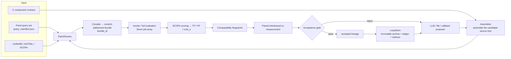

# Architecture

This document describes the code layering, the data flow, and the key invariants. The module
inventory is in README §6.

---

## 1. Responsibilities of the three layers

The project separates three questions — *what to change*, *how to change it*, and *whether it
counts*. Each round therefore touches exactly one C component, attribution stays clean, and a
failure in one layer cannot silently contaminate another.

| Layer | Responsibility | Main modules |
|---|---|---|
| **Outer (algorithm plan)** | Choose the algorithm family, bind the unique C component contract, freeze the target file and the permitted functions | `c_patch_loop/controller.py`, `c_patch_loop/context.py`, `components/c_kernels.py` |
| **Inner (implementation trials)** | Generate C patch → static validation → apply patch → compile | `c_patch_loop/proposer.py`, `assembler.py`, `unified_diff.py`, `hmmer_instrument.py` |
| **Evaluation and measurement** | Two-stage evaluation, SCOPe scoring, comparability fingerprint, paired re-measurement, record archiving | `c_patch_loop/runner.py`, `run_hmmer_cli.py`, `slurm_eval.py`, `scorer.py`, `c_patch_loop/comparability.py` |

---

## 2. Data flow



---

## 3. Content addressing and reuse

Compiled HMMER bundles are stored content-addressed: the source hash, the patch hash, and the
build context together determine `bundle_id`. All query tasks in a batch reuse the same bundle,
so "compile once, evaluate many times" holds, and **any input change yields a different bundle**,
so an outdated binary cannot be used by mistake.

Relevant fields (see the record structure in `c_patch_loop/ledger.py`):
`hmmer_source_sha256`, `patch_set_sha256`, `build_context`, `bundle_id`.

---

## 4. Two-level memory (why conversation history is not used as memory)

The agent's context limit is 256k tokens, but one optimization round produces a large amount of
evidence. `EXPERIENCE_DESIGN.md` splits it into three layers:

```
① Immutable raw evidence   context_packs / patch_plans / patchsets / evaluations / experience.jsonl
        │
        ▼  regenerate (regenerable projection)
② Derived indexes          indexes/*.json (speed-best, accepted lineage, leaderboard, experience statistics)
        │
        ▼  compress (carrying eval_id / patchset_id / diff_sha256 for back-reference)
③ Model-facing summary     compressed_summary.md (64k token cap for the outer layer)
```

**Key invariant**: every entry in ③ can be traced back to ① by id.
The summary is therefore auditable, rather than a model narrative that cannot be traced.

---

## 5. State and recoverability

- Loop state lives **entirely** under `RUN_DIR` (`c_patch_loop/` records + slot events),
  so archiving the directory is enough for an audit;
- The same command with the same run directory **re-attaches** to the same invocation; it does not
  re-propose, nor re-submit a Slurm array job that is still running or already finished;
- A process lock on the run directory prevents two controllers from advancing it at the same time;
- The engine advances one step at a time only until it needs the next proposal, then returns
  control to the agent (`hloop_cli.py` writes a single line of JSON to stdout; logs go to
  stderr) — so its output can be piped directly to `jq`, and the agent does not have to maintain
  loop state itself.

---

## 6. Why the two-stage evaluation is fixed

```
jackhmmer(-N3) → highest-iteration checkpoint → hmmsearch(ASTRAL) → hmmsearch.tbl → SCOPe scoring
```

`docs/AGENT_PROMPT.md` lists this explicitly as a **fixed pipeline that must not be modified**:
the agent may neither change the pipeline nor run HMMER evaluations directly through a shell.

The reason is directly tied to verification: if a candidate and the reference could follow
different evaluation pipelines, their `cost_s` values would **no longer be comparable**, and any
speedup would lose its meaning. This constraint is therefore a precondition for measurement
credibility, not merely an engineering convention.

---

## 7. Environment and configuration

- Uncommitted site configuration is specified through `SEQ_ALIGN_CONFIG`;
  what is committed to the repository is `configs/config.example.yaml` (no credentials, no site paths).
- `conftest.py` **clears** all `SEQ_ALIGN_*` environment variables before the tests start,
  because `source env.sh` carries these variables into the shell and would otherwise make test
  results depend on who is running them — for example, `SEQ_ALIGN_EVAL_BACKEND=slurm`
  would make a test that should use the stub actually submit jobs.
